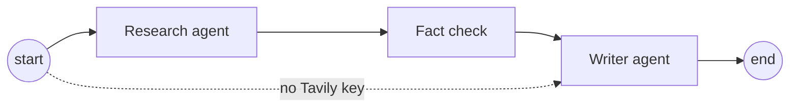
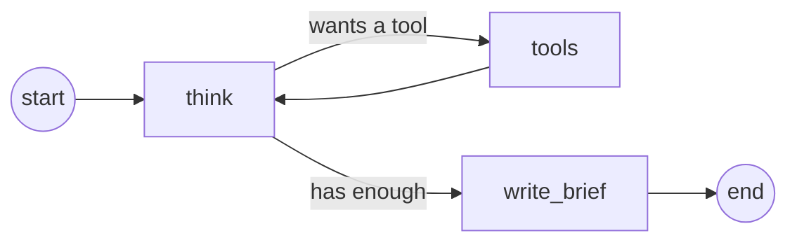
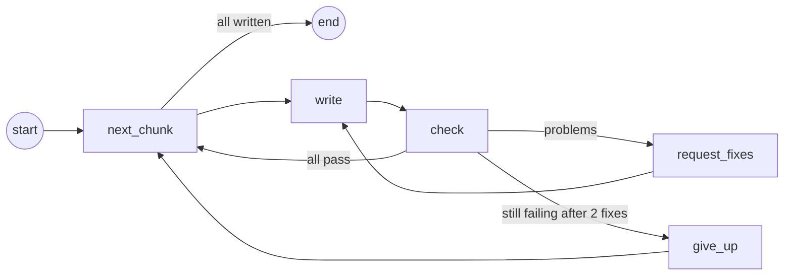

# Post orchestrator

Forethrive's kit for LinkedIn posts. Every post gets the same look from **Post
Studio** (`post-studio.html`), the brand guide and image tool for social posts.
On top of it, a generator can decide what to post and write it, or polish
something you've drafted.

Nothing is posted automatically. People choose and post every draft.

## How to use it

Pick the row that fits what you have:

| You have… | Do this | You get |
| --- | --- | --- |
| Finished words for a post | Open `post-studio.html` and fill it in by hand | One image, in a minute |
| A rough idea or write-up for a post | **Claude:** `/polish-post` · **API key:** `python -m agents.polish my-draft.txt` | Your post, polished and ready: image, caption and first comment |
| Nothing yet ("give us ideas") | **Claude:** `/generate-posts` · **API key:** `python -m agents.generate` | A researched batch of 14 drafts to pick from |

- **Claude** means the Claude desktop app's Code tab, opened in this folder.
- **API key** means the Python agents with a key from OpenAI, Gemini, Groq or
  Anthropic in a `.env` file (see [Setting up a computer](#setting-up-a-computer-once)).

Both follow the same writing rules, pass the same checks and draw with the same
Post Studio.

### I have the finished words: fill in Post Studio by hand

1. Open `post-studio.html` in Chrome (double-click it).
2. Pick a post type: Announcement, AI insight, Stat, Client win or Hiring. It
   fills in an example for you to replace.
3. Type the label, the big number (optional), the headline and the supporting
   line. The preview updates as you type.
4. Choose portrait (best for LinkedIn) or square, and click **Download image
   (PNG)**.
5. Write the caption using the caption format further down the page. That
   means a hook under 125 characters, a few short lines, one action, and up to
   three hashtags, with the link going in the first comment.

### I have a rough idea: polish it into a post

Write roughly what you want to say, in a text file or straight into the
command: the point, the facts, who it's for. For example:

> Client win we want to share. A logistics client had 3 people typing invoices
> into their ERP. We built a document AI that reads them and fills the ERP, with
> a person checking unsure ones. Invoice work went from 3 days to 4 hours a
> week. We can't name the client.

- **With Claude:** type `/polish-post` and paste the draft, or give the file's
  path. Ask for "3 versions" to get a few to choose from.
- **With an API key:** run `python -m agents.polish my-draft.txt`, or put the
  text itself in quotes. Add `--versions 3` for a few to choose from.

It keeps your message and your facts, and improves the hook, the wording and
the structure. It fills in every Post Studio field and writes the caption and
first comment. It can't add numbers that aren't in your draft or in
`brand/facts.md`, because the check rejects them. Then the image is drawn and
the review page opens.

### I want ideas: generate a batch

- **With Claude:** type `/generate-posts` (or `/generate-posts 6` for fewer).
- **With an API key:** run `python -m agents.generate` (add `--count 6` for
  fewer).

It researches recent AI news, checked numbers and what similar companies post.
Then it writes 14 varied drafts, checks them, draws them and opens the review
page. A batch takes a few minutes. See
[How the generator works](#how-the-generator-works).

### Reviewing, sharing and posting

After polishing or generating, the review page opens at http://localhost:4400.

1. Approve the drafts you want and skip the rest. Clicking a button again
   undoes it.
2. To change a post, click **Edit**. Change any field (label, big number,
   headline, supporting line, caption, hashtags or first comment). The image
   redraws as you type, and any brand-rule problems show straight away.
   **Save** works once everything passes; **Cancel** keeps the post as it was.
3. To share the shortlist, click **Export shortlist**. It saves and downloads
   one zip of the approved posts, ready to attach to an email:

   | In the zip | For |
   | --- | --- |
   | `shortlist.pdf` | Reading and approving. One post per page, opens in any mail app or phone. |
   | `shortlist.html` | Everything in one file, with copy and download buttons. Opens in any browser. |
   | `images/` | The full-quality PNGs to post |
   | `captions.txt` | Every caption and first comment, numbered |

   A batch of 14 comes to about 15 MB, under Gmail's 25 MB limit. From a
   terminal, `npm run export` does the same.
4. To post an approved draft:
   1. Download the image.
   2. On LinkedIn, switch to the Forethrive page and start a post.
   3. Add the image and paste the caption, then post it.
   4. Paste the first comment, which has the link.
   5. Mark it posted on the review page, so later batches don't repeat it.
5. Stop the review page with Ctrl+C in its terminal. Open it again later with
   `npm run review`.

## Setting up a computer (once)

1. Install [Node.js](https://nodejs.org) (version 20 or newer) and Google Chrome.
2. In this folder, run `npm install`. That downloads Playwright, the library
   that controls Chrome for drawing images.
3. Copy `brand/ideas.example.md` to `brand/ideas.md` and add real projects,
   wins, news and open roles.
4. Check the items marked "Not confirmed" in `brand/company.md`.
5. Then set up Claude, the Python agents, or both.

### With Claude

Install the Claude desktop app and sign in. Open this folder in its Code tab;
`/generate-posts` and `/polish-post` are ready to use.

### With an API key (the Python agents)

1. Install [Python](https://www.python.org/downloads/) 3.11 or newer.
2. In this folder, make a virtual environment, a private folder of Python
   packages just for this project, and install the agents' packages into it:

   ```bash
   python3 -m venv .venv
   source .venv/bin/activate
   pip install -r requirements.txt
   ```

   In a new terminal later, run `source .venv/bin/activate` again before using
   the agents.
3. Get an API key from one provider:

   | Provider | Where to get a key | `.env` setting | Default model |
   | --- | --- | --- | --- |
   | Gemini | [Google AI Studio](https://aistudio.google.com/apikey) | `GEMINI_API_KEY` | `gemini-3.8-flash` |
   | Groq | [Groq console](https://console.groq.com/keys) | `GROQ_API_KEY` | `openai/gpt-oss-120b` |
   | OpenAI | [OpenAI platform](https://platform.openai.com/api-keys) | `OPENAI_API_KEY` | `gpt-6.1-sol` |
   | Anthropic | [Claude console](https://console.anthropic.com/settings/keys) | `ANTHROPIC_API_KEY` | `claude-sonnet-5-5` |
   | Any OpenAI-compatible service | Your service | `LLM_API_KEY`, `LLM_BASE_URL` | Set `LLM_MODEL` |

4. Copy `.env.example` to `.env`, set `LLM_PROVIDER` to the provider's name,
   and paste the key on its line. `.env` is never committed, so the key stays
   on your computer. To use a different model, set `LLM_MODEL`.
5. For web research, also get a key from [Tavily](https://app.tavily.com) (it
   has a free tier) and set `TAVILY_API_KEY`.

**What gets sent where:** the AI provider receives the brand guide,
`brand/company.md`, `brand/facts.md`, `brand/ideas.md`, earlier posts, the
research and your drafts. The ideas list can hold client details, so check your
provider's data terms. Some free tiers use what you send to improve their
models. Tavily receives only the search queries and the links the agent reads.

## How the generator works

1. **Read.** It reads the brand guide in Post Studio, the company notes in
   `brand/company.md`, the checked facts in `brand/facts.md`, the team's ideas
   in `brand/ideas.md`, and every earlier batch, so it doesn't repeat itself.
2. **Research.** It searches the web for recent AI news, numbers from primary
   sources, and what similar companies are posting on LinkedIn. Every number
   is checked against the page it came from.
3. **Plan and write.** It writes 14 varied drafts. For each one it fills in
   Post Studio's fields (label, big number, headline, supporting line) and
   writes the caption and first comment.
4. **Check.** Every draft is tested against the brand guide by `npm run
   validate`. That covers headline length, the 125-character hook, allowed
   hashtags, banned buzzwords, no emojis in images, no numbers without a
   source, and no source that isn't a checked fact. Drafts that fail go back to
   be fixed.
5. **Draw.** Post Studio draws each image in a hidden Chrome window, so they
   match images made by hand exactly.
6. **Review.** The review page opens for you to pick the best.

**Nothing is invented.** Numbers come only from `brand/facts.md`, where each
one is listed with the source someone opened and checked, or from research
whose quotes were matched to their pages. Client wins, announcements and hiring
posts come only from what the team writes in `brand/ideas.md` or in a draft.
Clients are named only when the idea or draft does. All of these rules are in
`brand/writing-rules.md`.

## Commands

| Command | What it does |
| --- | --- |
| `python -m agents.generate` | Researches and writes a batch with your API keys, draws it and opens the review page. Add `--no-research` to skip the research. |
| `python -m agents.polish my-draft.txt` | Turns your rough draft into a polished post. Add `--versions 3` for a few to choose from. |
| `npm run validate` | Checks the newest batch against the brand guide |
| `npm run render` | Draws the newest batch's images with Post Studio |
| `npm run review` | Opens the review page for the newest batch |
| `npm run export` | Exports the newest batch's approved posts as a zip to share (`-- --all` for every post not skipped) |

Each command works on the newest batch unless you name another one, for example
`npm run review -- posts/2026-10-13`.

## What's where

| Path | What it is |
| --- | --- |
| `post-studio.html` | Post Studio. Open it in a browser to make a post by hand. |
| `.claude/skills/` | Instructions for Claude Code: `generate-posts` and `polish-post` |
| `brand/writing-rules.md` | How to plan and write posts: types, facts, fields, captions |
| `brand/company.md` | What Forethrive does and who the posts are for |
| `brand/facts.md` | Checked statistics with their sources. Posts may cite these. |
| `brand/research-rules.md` | What the Research agent looks for and how |
| `brand/ideas.example.md` | The format for `brand/ideas.md` |
| `brand/rules.js` | The brand guide's limits, used by the validator |
| `agents/` | The Python agents, built with LangGraph (see below) |
| `docs/how-the-agents-work.md` | How the agents work, step by step, and how they were built |
| `requirements.txt` | The Python packages the agents need |
| `.env.example` | The settings template for the Python agents |
| `scripts/` | The validate, render and review scripts (shared code in `scripts/lib/`) |
| `review/index.html` | The review page, including editing |
| `review/shortlist.html` | The design of the exported shortlist (HTML and PDF) |
| `posts/` | One folder per batch, with `posts.json` and the images |

`.env`, `brand/ideas.md` and `posts/` are never committed (see `.gitignore`).
They hold API keys, client details and unannounced news, and this repository is
public. They live only on the computer that makes the posts.

For a beginner-friendly explanation of how the agents work and how they were
built, see [docs/how-the-agents-work.md](docs/how-the-agents-work.md).

### How the Python and JavaScript parts fit together

The Python agents do the thinking: they decide what to write and talk to the AI
provider. Checking, drawing and reviewing stay with the JavaScript tools in
`scripts/`, which Claude Code uses too. The agents check each post by running
`scripts/validate.js --json`, so the brand rules live in one place and every
way of making posts is held to them.

### The agents

`python -m agents.generate` runs the post orchestrator (`agents/orchestrator.py`),
a [LangGraph](https://docs.langchain.com/oss/python/langgraph/overview) graph with
two agents and a fact check between them:



### The Research agent

It works like a researcher with a browser. Given today's date and what
Forethrive has already posted, it decides what to look for, uses its tools,
reads what comes back, and decides what to do next, until it has enough
material for the batch (or has taken 12 turns).



Its three tools (`agents/research_tools.py`):

- **search_web** searches the web through Tavily, optionally only the last
  month, for news and for surveys and studies with numbers.
- **search_linkedin** searches public LinkedIn posts, to see what AI
  consultancies and automation firms are posting: their themes, formats and
  hooks. It only sees what search results show. It never logs in to LinkedIn
  or opens LinkedIn pages, which LinkedIn's terms forbid. The posts are for
  ideas only, and the writer never copies their wording.
- **read_page** reads a web page or PDF, so the agent can copy exact quotes. It
  won't open LinkedIn or addresses on your own network.

When it's done, it writes a **research brief**: recent news, facts with exact
quotes, inspiration from similar companies, and angles for Forethrive. What it
looks for is set in `brand/research-rules.md`, in plain English, so anyone can
change it.

For web research, get a key from [Tavily](https://app.tavily.com) (it has a
free tier) and set `TAVILY_API_KEY` in `.env`. Without it, or with
`--no-research`, research is skipped and posts use only the facts in
`brand/facts.md`. Tavily receives only the search queries and the links the
agent reads.

### The fact check

Plain code, not AI (`agents/verify.py`). For every fact in the brief, the quote
must appear word for word on the page the agent read, and every number in the
claim must appear in the quote. Facts that fail are dropped, and the Writer
agent may only cite facts that passed. The brief and the check's results are
saved with the batch as `research.md` (to read) and `research.json` (for the
checker). To reuse a good fact in later batches, copy it into `brand/facts.md`.

### The Writer agent

`agents/writer.py` writes the posts from the brief:



- **next_chunk** picks the next five posts to write. Small requests stay within
  free-tier limits.
- **write** asks the model for those posts in an exact shape (described in
  `agents/schema.py`), so every field Post Studio needs is there.
- **check** runs the same checks as `npm run validate` on every post.
- **request_fixes** sends failing posts back with the problems listed. After
  two tries, **give_up** drops a post rather than save a bad one.

`python -m agents.polish` uses the same Writer agent with your draft instead of
a brief. It writes one post (or a few versions) from the draft. On top of the
usual checks, it rejects any number that isn't in the draft or `brand/facts.md`.

If the brand guide in Post Studio changes, update `brand/rules.js` and
`brand/writing-rules.md` to match.

## To do

- [ ] **Send drafts by email through Gmail,** so people can review on their
  phones:
  - **One email per post:** image attached, caption ready to copy, first comment
    and sources. One per post keeps each email under Gmail's 25 MB limit and
    makes it easy to post straight from a phone.
  - **No paid service:** send through a Gmail account with an app password. The
    account needs 2-Step Verification, and on Google Workspace the admin has to
    allow app passwords. The password goes in a local `.env` file that's never
    committed.
  - **Approve and Skip buttons** open a pre-filled reply. The next run reads the
    replies and updates each post's status. Later, a free Google Apps Script
    could make these true one-tap buttons.
- [ ] **Run on a schedule** with a Claude scheduled routine, so batches arrive
  without anyone starting them. Ideas and batches would then need to live
  somewhere shared instead of on one Mac.
- [ ] **Post to LinkedIn after approval.** Posting as the company page needs a
  LinkedIn developer app approved for the Community Management API.
- [ ] **Carousels.** The guide describes 5 to 8 slide posts. LinkedIn takes
  carousels as PDFs, so the generator would draw each slide and combine them.
- [ ] **Confirm the facts** listed under "Not confirmed" in `brand/company.md`.
