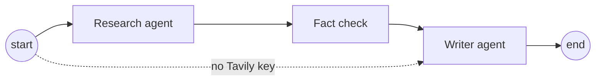
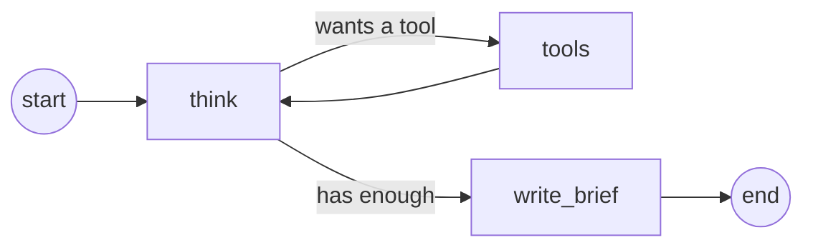
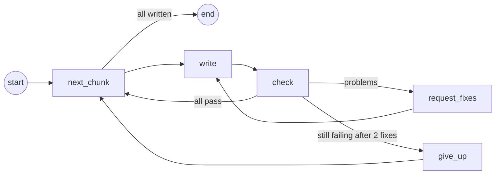

# Post orchestrator

Forethrive's kit for LinkedIn posts:

- **Post Studio** (`post-studio.html`) gives every post the same look. It's the
  brand guide for social posts and the tool that draws post images.
- **The generator** decides what to post, writes it, and draws the images with
  Post Studio. It drafts a batch of 14 posts, the team picks the best ones on a
  review page, and someone posts them on the Forethrive company page.

Nothing is posted automatically. People choose and post every draft.

There are two ways to run the generator:

| | **`npm run generate`** | **`/generate-posts` in Claude Code** |
| --- | --- | --- |
| Needs | An API key from OpenAI, Gemini, Groq or Anthropic | The Claude desktop app |
| Who writes | The Research and Writer agents, built with LangGraph | Claude, following `.claude/skills/generate-posts` |
| Research | The Research agent searches the web with a Tavily key (or uses `brand/facts.md` without one) | Claude searches the web and adds new facts to `brand/facts.md` |

Both follow the same rules (`brand/writing-rules.md`), pass the same checks,
draw with the same Post Studio, and open the same review page.

## How the generator works

1. **Read.** It reads the brand guide in Post Studio, the company notes in
   `brand/company.md`, the checked facts in `brand/facts.md`, the team's ideas
   in `brand/ideas.md`, and every earlier batch, so it doesn't repeat itself.
2. **Research.** It searches the web for recent AI news, numbers from primary
   sources, and what similar companies are posting on LinkedIn. Every number
   is checked against the page it came from.
3. **Plan and write.** It writes 14 varied drafts. For each one it fills in
   Post Studio's fields (label, big number, headline, supporting line) and
   writes the caption and first comment.
4. **Check.** Every draft is tested against the brand guide. That covers
   headline length, the 125-character hook, allowed hashtags, banned buzzwords,
   no emojis in images, no numbers without a source, and no source that isn't
   a checked fact. Drafts that fail go back to be fixed.
5. **Draw.** Post Studio draws each image in a hidden Chrome window, so they
   match images made by hand exactly.
6. **Review.** A page opens at http://localhost:4400. You approve the best
   drafts, skip the rest, and mark them posted once they're live.

**Nothing is invented.** Numbers come only from `brand/facts.md`, where each
one is listed with the source someone opened and checked, or from research
whose quotes were matched to their pages. Client wins,
announcements and hiring posts come only from what the team writes in
`brand/ideas.md`. Clients are named only when the idea says that's allowed.

## Setting up a computer (once)

1. Install [Node.js](https://nodejs.org) (version 20 or newer) and Google Chrome.
2. In this folder, run `npm install`. That downloads the libraries the
   generator uses, including LangGraph for the agents and Playwright for
   controlling Chrome.
3. Copy `brand/ideas.example.md` to `brand/ideas.md` and add real projects,
   wins, news and open roles.
4. Check the items marked "Not confirmed" in `brand/company.md`.
5. Then set up one of the two ways below.

### With an API key

1. Get an API key from one provider:

   | Provider | Where to get a key | `.env` setting | Default model |
   | --- | --- | --- | --- |
   | Gemini | [Google AI Studio](https://aistudio.google.com/apikey) | `GEMINI_API_KEY` | `gemini-3.8-flash` |
   | Groq | [Groq console](https://console.groq.com/keys) | `GROQ_API_KEY` | `openai/gpt-oss-120b` |
   | OpenAI | [OpenAI platform](https://platform.openai.com/api-keys) | `OPENAI_API_KEY` | `gpt-6.1-sol` |
   | Anthropic | [Claude console](https://console.anthropic.com/settings/keys) | `ANTHROPIC_API_KEY` | `claude-sonnet-5-5` |
   | Any OpenAI-compatible service | Your service | `LLM_API_KEY`, `LLM_BASE_URL` | Set `LLM_MODEL` |

2. Copy `.env.example` to `.env`, set `LLM_PROVIDER` to the provider's name,
   and paste the key on its line. `.env` is never committed, so the key stays
   on your computer.
3. For web research, get a key from [Tavily](https://app.tavily.com) (it has a
   free tier) and set `TAVILY_API_KEY`. Without it, posts use only the facts in
   `brand/facts.md`.
4. To use a different model, set `LLM_MODEL`.

**What gets sent where:** the AI provider receives the brand guide,
`brand/company.md`, `brand/facts.md`, `brand/ideas.md`, earlier posts and the
research. The ideas list can hold client details, so check your provider's data
terms. Some free tiers use what you send to improve their models. Tavily
receives only the search queries and the links the agent reads.

### With Claude Code

Install the Claude desktop app and sign in. The generator runs in its Code tab.

## Making a batch of posts

1. Start the generator:
   - With an API key: run `npm run generate`. Add `-- --count 6` for a
     different number of drafts.
   - With Claude Code: open this folder in the Code tab and type
     `/generate-posts` (or `/generate-posts 6`).

   A batch takes a few minutes.
2. The review page opens at http://localhost:4400.
3. Approve the drafts you want and skip the rest. Clicking a button again
   undoes it.
4. To post an approved draft:
   1. Download the image.
   2. On LinkedIn, switch to the Forethrive page and start a post.
   3. Add the image and paste the caption, then post it.
   4. Paste the first comment, which has the link.
   5. Mark it posted on the review page.
5. Stop the review page with Ctrl+C in its terminal. Open it again later with
   `npm run review`.

## The agents

`npm run generate` runs the post orchestrator (`scripts/agents/orchestrator.js`),
a [LangGraph](https://docs.langchain.com/oss/javascript/langgraph/overview) graph
with two agents and a fact check between them:

### The Research agent

It works like a researcher with a browser. Given today's date and what
Forethrive has already posted, it decides what to look for, uses its tools, reads
what comes back, and decides what to do next, until it has enough material for
the batch (or has taken 12 turns).

Its three tools (`scripts/agents/research-tools.js`):

- **search_web** searches the web through Tavily, optionally only the last
  month, for news and for surveys and studies with numbers.
- **search_linkedin** searches public LinkedIn posts, to see what AI
  consultancies and automation firms are posting: their themes, formats and
  hooks. It only sees what search results show. It never logs in to LinkedIn
  or opens LinkedIn pages, which LinkedIn's terms forbid. The posts are for
  ideas only, and the writer never copies their wording.
- **read_page** reads a web page or PDF, so the agent can copy exact quotes. It
  won't open LinkedIn or addresses on your own network.

When it's done, it writes a **research brief**: recent news, facts with exact
quotes, inspiration from similar companies, and angles for Forethrive. What it
looks for is set in `brand/research-rules.md`, in plain English, so anyone can
change it.

### The fact check

Plain code, not AI (`scripts/agents/verify.js`). For every fact in the brief,
the quote must appear word for word on the page the agent read, and every
number in the claim must appear in the quote. Facts that fail are dropped, and
the Writer agent may only cite facts that passed. The brief and the check's
results are saved with the batch as `research.md` (to read) and
`research.json` (for the checks). To reuse a good fact in later batches, copy it
into `brand/facts.md`.

### The Writer agent

`scripts/agents/writer.js` writes the posts from the brief:

- **next_chunk** picks the next five posts to write. Small requests stay within
  free-tier limits.
- **write** asks the model for those posts in an exact shape (described in
  `scripts/agents/schema.js`), so every field Post Studio needs is there.
- **check** runs the same checks as `npm run validate` on every post.
- **request_fixes** sends failing posts back with the problems listed. After
  two tries, **give_up** drops a post rather than save a bad one.

## Commands

| Command | What it does |
| --- | --- |
| `npm run generate` | Researches and writes a batch with your API keys, draws it and opens the review page. Add `-- --no-research` to skip the research. |
| `npm run validate` | Checks the newest batch against the brand guide |
| `npm run render` | Draws the newest batch's images with Post Studio |
| `npm run review` | Opens the review page for the newest batch |

The last three work on the newest batch unless you name another one, for
example `npm run review -- posts/2026-10-13`.

## What's where

| Path | What it is |
| --- | --- |
| `post-studio.html` | Post Studio. Open it in a browser to make a post by hand. |
| `brand/writing-rules.md` | How to plan and write posts: types, facts, fields, captions |
| `brand/company.md` | What Forethrive does and who the posts are for |
| `brand/facts.md` | Checked statistics with their sources. Posts may cite these. |
| `brand/research-rules.md` | What the Research agent looks for and how |
| `brand/ideas.example.md` | The format for `brand/ideas.md` |
| `brand/rules.js` | The brand guide's limits, used by the checks |
| `scripts/agents/` | The Research and Writer agents, the fact check, and the provider settings |
| `scripts/` | The generate, validate, render and review commands (shared code in `scripts/lib/`) |
| `.claude/skills/generate-posts/SKILL.md` | The generator's instructions for Claude Code |
| `.env.example` | The settings template for `npm run generate` |
| `review/index.html` | The review page |
| `posts/` | One folder per batch, with `posts.json`, the images and any research |

`.env`, `brand/ideas.md` and `posts/` are never committed (see `.gitignore`).
They hold API keys, client details and unannounced news, and this repository is
public. They live only on the computer that makes the posts.

If the brand guide in Post Studio changes, update `brand/rules.js` and
`brand/writing-rules.md` to match.

## To do

- [ ] **Send drafts by email through Gmail,** so people can review on their
  phones:
  - **One email per post:** image attached, caption ready to copy, first comment
    and sources. One per post keeps each email under Gmail's 25 MB limit and
    makes it easy to post straight from a phone.
  - **No paid service:** send through a Gmail account with an app password. The
    account needs 2-Step Verification, and on Google Workspace the admin has to
    allow app passwords. The password goes in the `.env` file, which is never
    committed.
  - **Approve and Skip buttons** open a pre-filled reply. The next run reads the
    replies and updates each post's status. Later, a free Google Apps Script
    could make these true one-tap buttons.
- [ ] **Run on a schedule,** so batches arrive without anyone starting them.
  Ideas and batches would then need to live somewhere shared instead of on one
  computer.
- [ ] **Post to LinkedIn after approval.** Posting as the company page needs a
  LinkedIn developer app approved for the Community Management API.
- [ ] **Carousels.** The guide describes 5 to 8 slide posts. LinkedIn takes
  carousels as PDFs, so the generator would draw each slide and combine them.
- [ ] **Confirm the facts** listed under "Not confirmed" in `brand/company.md`.
