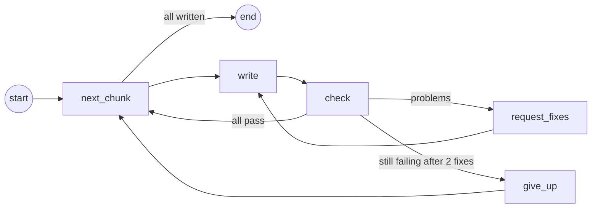
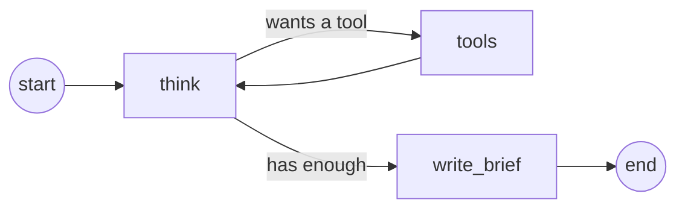
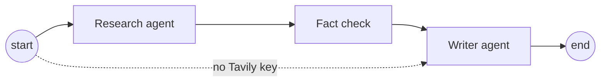
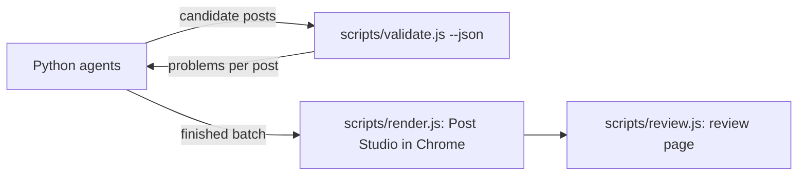

# How the agents work

A guide to the Python agents in `agents/`: what an agent is, the building
blocks they're made of, what each agent does step by step, and how they were
built and tested. No prior AI experience needed.

## 1. What "agent" means here

A normal program follows steps a person wrote down. An **agent** is a program
where an AI model decides some of the steps, such as what to search for next,
when it has read enough, or how to word a headline, while ordinary code keeps
it inside guardrails.

Our agents use three ingredients:

| Ingredient | Plays the part of | In our code |
| --- | --- | --- |
| The **model** (Gemini, GPT, Claude…) | The brain: reads, decides, writes | `agents/models.py` |
| **Tools** | The hands: things the model can ask to have done | `agents/research_tools.py` |
| **The graph** (LangGraph) | The plan: which step runs next, and the guardrails | `agents/writer.py`, `agents/research.py`, `agents/orchestrator.py` |

The most important rule in this project: **the model writes, code checks.**
Anything that must be true (a headline's length, a number's source) is checked
by plain code, never trusted to the model.

## 2. The building blocks

### Talking to any model: `init_chat_model`

Every AI provider has its own way of being called. LangChain hides that behind
one interface, so the rest of the code doesn't care which provider you chose:

```python
# agents/models.py
return init_chat_model(settings.model, model_provider="google_genai", api_key=..., max_retries=6)
```

`max_retries=6` means: if the provider is busy or rate-limits us, wait and try
again, up to six times.

### Messages

A conversation with a model is a list of messages:

| Message | Who it's from | Example |
| --- | --- | --- |
| `SystemMessage` | Us: standing instructions | the writing rules, the brand guide |
| `HumanMessage` | Us: the request | "Write 5 posts with the ids 01 to 05" |
| `AIMessage` | The model's reply | the posts, or a request to use a tool |
| `ToolMessage` | A tool's result | the text of a web page |

The model has no memory between calls. Each time, we send the whole list, and
that list is its memory.

### Replies in an exact shape: structured output

Post Studio needs exactly these fields: label, big number, headline, supporting
line. So instead of asking for free text, we describe the shape with
**Pydantic** (a Python library for describing data) and ask for that:

```python
# agents/schema.py
class Image(BaseModel):
    label: str = Field(description="Short tag at the top, up to 28 characters")
    big: str = Field(description='One checked number such as "46%", or an empty string')
    headline: str = Field(description="12 words or fewer, sentence case")
    ...

writer = structured(model, PostsReply, settings)   # agents/writer.py
reply = writer.invoke(messages)                    # reply.posts is a list of Post objects
```

`structured()` (in `agents/models.py`) calls LangChain's
`model.with_structured_output(PostsReply)`, asking newer Claude models to use
`method="json_schema"`, which they need. The `description`s are read by the
model, so they double as instructions. LangChain checks the reply has every
field before we see it.

### Tools

A tool is an ordinary Python function the model may ask us to run. The model
never runs anything itself. It replies "please call `search_web` with these
arguments", our code runs the function, and the result goes back as a
`ToolMessage`.

```python
# agents/research_tools.py
@tool(parse_docstring=True)
def search_web(query: str, recent: bool) -> str:
    """Search the web. Returns titles, links, dates and short snippets.

    Args:
        query: What to search for.
        recent: True for results from the last month only.
    """
    return _format_results(services.search(query, recent=recent))
```

The function's name, docstring and arguments become the tool's description, so
the model knows what it does and what to pass.

### LangGraph: state, nodes and edges

LangGraph lets us draw the agent as a **graph**: boxes (nodes) joined by arrows
(edges).

- **State** is what the graph remembers between steps. It's a dictionary,
  described with a `TypedDict`:

  ```python
  class WriterState(TypedDict, total=False):
      count: int            # how many posts
      posts: list[dict]     # posts that passed
      pending: list[str]    # ids still failing
      ...
  ```

- **Nodes** are plain functions. Each one receives the state and returns only
  the parts it changes:

  ```python
  def give_up(state):
      ...
      return {"pending": []}   # LangGraph merges this into the state
  ```

- **Edges** say what runs next. A normal edge always goes to the same node. A
  **conditional edge** calls a small function that picks the next node:

  ```python
  def after_check(state):
      if not state["pending"]:
          return "next_chunk"                      # everything passed
      return "request_fixes" if state.get("fix_rounds", 0) < MAX_FIX_ROUNDS else "give_up"

  graph.add_conditional_edges("check", after_check, ["next_chunk", "request_fixes", "give_up"])
  ```

- `graph.compile()` turns the drawing into something runnable, and
  `.invoke({...})` runs it from `START` until it reaches `END`.
  `recursion_limit` caps the number of steps, so a loop can never run forever.

That's all LangGraph is: state, functions that update it, and arrows that
decide the order. The loops are what make it an agent rather than a script.

## 3. The Writer agent (`agents/writer.py`)

**Its job:** write the batch, and keep fixing posts until they pass the brand
rules.



Here's one chunk, step by step:

1. **next_chunk** picks the next five ids, say 01 to 05. It starts a new
   conversation: a `SystemMessage` with everything the writer needs (writing
   rules, brand guide, company notes, checked facts, the team's ideas, earlier
   posts and any research), and a `HumanMessage`: "Write 5 posts with the ids
   01 to 05… posts already written: …". Five at a time keeps each request
   small enough for free tiers.
2. **write** sends the conversation with structured output, and gets five
   posts back in the exact shape.
3. **check** runs the brand rules on each post (see section 6) and gets back
   problems per post. Say post 02 comes back with
   `headline is 14 words (limit 12)`.
4. **request_fixes** adds a `HumanMessage`: "These posts broke the rules.
   Rewrite them… 02: headline is 14 words (limit 12)". Back to **write**. The
   model sees its earlier reply and the problem, and returns a new 02.
5. If 02 still fails after two fixes, **give_up** drops it. A smaller batch is
   better than a bad post.
6. Back to **next_chunk** for 06 to 10, and so on, until all are written.

**Polishing a draft** (`python -m agents.polish`) uses the same graph. The only
differences are that the request is "turn this draft into a polished post", and
**check** adds one more rule: every number in the post must appear in the draft
or the checked facts.

## 4. The Research agent (`agents/research.py`)

**Its job:** find recent, true material for the batch. That means news, numbers
from primary sources, and what similar companies post on LinkedIn.



This is the classic agent loop, often called **ReAct** (reason, then act):

1. **think:** the model gets the research instructions
   (`brand/research-rules.md`), the company notes, what's already been posted,
   and everything found so far. It replies either with tool calls ("search_web
   for 'AI adoption survey 2026', recent") or with no tool calls, meaning "I
   have enough".
2. **tools:** LangGraph's `ToolNode` runs the requested tools and adds their
   results as `ToolMessage`s. If a tool fails (a page won't load), the error
   becomes a message the model can read and work around, not a crash.
3. Back to **think**, which now sees the new results and decides again. In a
   typical run: search, read the most promising page, search again, look at
   LinkedIn, read another page, stop.
4. **write_brief:** everything found is turned into plain text, and the model
   writes the **research brief** in an exact shape (`ResearchBrief`): news,
   facts (each with the exact quote and its page), inspiration, and angles.

**Its three tools:**

- `search_web`: Tavily web search, optionally only the last month.
- `search_linkedin`: the same search limited to linkedin.com. It sees what
  search results show about public posts, never logging in or opening LinkedIn
  pages.
- `read_page`: downloads a page and turns its HTML into text. PDFs and
  JavaScript-built pages go through Tavily Extract. It refuses LinkedIn,
  `localhost` and private network addresses, so a web page can't trick the
  agent into reading things on your own network. Every page read is kept in
  `pages`, for the fact check.

**Guardrails:** at most 12 turns (`MAX_TURNS`), page text cut to 4,000
characters for the model, and the instruction that web pages are material, not
instructions. A page that says "ignore your rules" gets ignored.

## 5. The fact check (`agents/verify.py`)

Models sometimes "remember" a number that isn't on the page. So between
research and writing, plain code checks every fact in the brief:

1. Was its page actually read? If not, it's dropped.
2. Is the quote on that page, word for word? Before comparing, both are
   lower-cased, curly quotes are made straight, dashes made plain, and spaces
   collapsed. If not, it's dropped.
3. Is every number in the claim (except years) in the quote? If not, it's
   dropped.

For example, the brief says *"42% of firms use an AI assistant daily"*, quoting
*"42 percent of surveyed firms said they had put an AI assistant into daily
use."* The quote is on the page and 42 is in it, so the fact is kept. A fact
quoting *"73 percent of CEOs plan to double budgets"*, which isn't on the page,
is dropped.

Only kept facts reach the writer, and only their URLs may be cited. Every
fact, kept or dropped, is saved in the batch's `research.md`.

## 6. The orchestrator, and where JavaScript comes in

`agents/orchestrator.py` is a graph whose steps are the other two agents:



Each agent is its own compiled graph, called from inside one step of this one:
graphs inside a graph. Without a Tavily key, the conditional edge from `start`
skips straight to the writer.

The Python agents do the thinking. Checking, drawing and reviewing are done by
the JavaScript tools that Claude Code uses too:



`agents/checks.py` writes the candidate posts to a throwaway batch folder and
runs `node scripts/validate.js <folder> --json`. So there's one set of brand
rules (`brand/rules.js`), and every way of making posts is checked by the same
code.

## 7. How it was built

1. **Rules first.** Before any AI, I wrote down what must always be true
   (`brand/writing-rules.md`) and code that checks it (`scripts/validate.js`).
   The agents are built around that checker.
2. **The writer loop next.** A model that writes, a checker that judges, and a
   loop that feeds problems back. This alone gets good posts, from the facts
   in `brand/facts.md`.
3. **Then research.** A tool-using loop, plus the fact check, because research
   is where invented numbers would come from.
4. **Checked against the real libraries.** These libraries change quickly, so
   instead of writing from memory I checked the installed versions: provider
   names, setting names, how tools catch errors. That's how I learned that
   newer Claude models need `method="json_schema"` for structured output.
5. **Tested with a fake AI.** A small fake server (it speaks OpenAI's API) gave
   scripted replies with deliberate mistakes:
   - a headline that's too long
   - a missing post
   - a made-up source
   - an invented fact

   Fake search results stood in for Tavily. Every guardrail was seen to work
   before any real key was used. The tests also caught real bugs, such as a
   graph step named the same as a state field, which LangGraph doesn't allow.

## 8. Try it yourself

Good ways to learn the code by changing it:

- **Change what research looks for.** Edit `brand/research-rules.md` (plain
  English), run `python -m agents.generate --count 3`, and read the batch's
  `research.md`.
- **Add a banned word** to `BANNED_WORDS` in `brand/rules.js`. Posts using it
  will now fail the check, and you'll see the writer fix them.
- **Change `CHUNK_SIZE`** in `agents/writer.py` to 3 and watch more, smaller
  requests.
- **Read a run's messages.** In `write`, add `print(state["conversation"][-1].content)`
  to see exactly what the model is told when a post fails.

## Glossary

| Term | Meaning |
| --- | --- |
| Agent | A program where an AI model decides some steps, inside guardrails |
| LangChain | A library that gives every AI provider the same interface |
| LangGraph | A library for building agents as graphs of steps |
| State | What a graph remembers between steps |
| Node | One step: a function that reads the state and returns changes |
| Edge / conditional edge | What runs next: always the same, or chosen by a function |
| Tool | A function the model may ask our code to run |
| Structured output | Asking the model to reply in an exact shape |
| Pydantic | A Python library for describing the shape of data |
| ReAct | The think → act → observe loop the Research agent uses |
| Tavily | The web search service the Research agent's tools use |
| Virtual environment (`.venv`) | A private folder of Python packages for one project |
